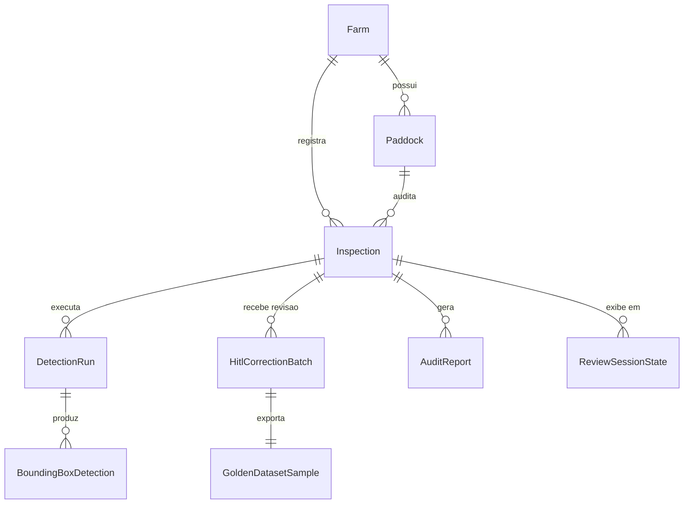
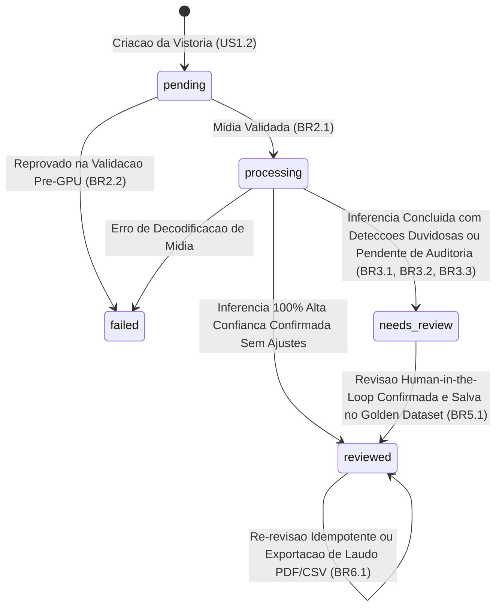
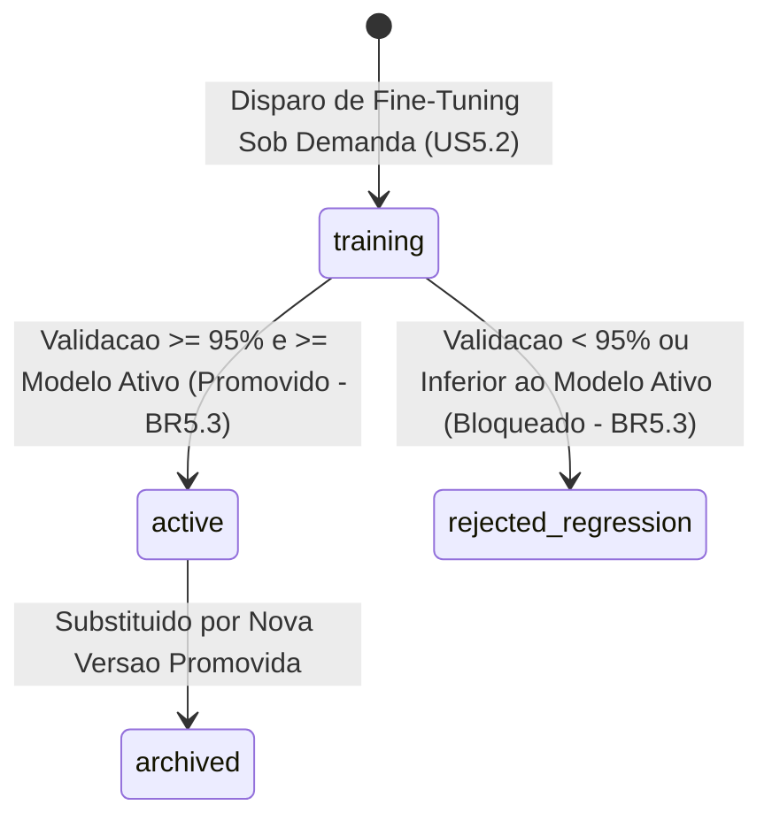

# Especificação Comportamental e Fluxos Funcionais (Functional Specification — `u1-agrocount-platform`)

Elaborado a partir de `units-generation/unit-of-work.md` (`unit-of-work.md`), `units-generation/unit-of-work-story-map.md` (`unit-of-work-story-map.md`), `user-stories/stories.md` (`stories.md` — cobrindo `US1.1` a `US6.1`), `requirements-analysis/requirements.md` (`requirements.md`), `domain-design/components.md` (`components.md`), `contract-design/contract-summary.md` (`contract-summary.md`), `entities.md` e `rules.md`.

## 1. Diagrama Entidade-Relacionamento Derivado (`entities.md`)

**Equivalente em texto:**
- `Farm` ($1:N$) $\rightarrow$ `Paddock`, `Inspection`
- `Inspection` ($1:N$) $\rightarrow$ `DetectionRun` ($1:N$) $\rightarrow$ `BoundingBoxDetection`
- `Inspection` ($1:N$) $\rightarrow$ `HitlCorrectionBatch` ($1:1$) $\rightarrow$ `GoldenDatasetSample`
- `Inspection` ($1:N$) $\rightarrow$ `AuditReport`

---

## 2. Máquinas de Estado do Ciclo de Vida (State Machines)

### 2.1 Máquina de Estados de `Inspection` (`BR1.2`, `BR3.3`, `BR5.1`)

### 2.2 Máquina de Estados de `ModelVersion` (`BR5.2`, `BR5.3`)

---

## 3. Fluxos Comportamentais Passo a Passo (Use Case Workflows)

### Fluxo WF-01: Ingestão Validada e Contagem por Visão Computacional (`US1.1`–`US3.3`)
1. O auditor seleciona ou cadastra uma `Farm` e um `Paddock` (`BR1.1`).
2. O auditor envia metadados e arquivo de foto ou vídeo para criação da `Inspection` (`BR1.2`, `BR2.1`).
3. O `InspectionManagementComponent` executa a regra `BR2.2` antes de alocar GPU:
   - Se o arquivo for vazio, tiver extensão fora de `{.jpg, .jpeg, .png, .mp4, .mov}`, exceder `50 MB` (imagem) ou exceder `500 MB` / `300s` (vídeo), interrompe imediatamente com erro estruturado `400`.
4. Sendo válido, o `CattleVisionEngineComponent` seleciona o modo de pipeline:
   - **Modo Foto (`yolo_sahi_image`, `BR3.1`):** Divide a imagem de alta resolução em janelas sobrepostas (*SAHI slicing*), executa detecção YOLO em cada janela e aplica *Non-Maximum Suppression (NMS)* para consolidar as caixas delimitadoras.
   - **Modo Vídeo (`yolo_bytetrack_video`, `BR3.2`):** Executa detecção quadro a quadro e associa caixas entre quadros via *ByteTrack*, atribuindo um `trackId` persistente a cada bovino e contabilizando apenas `trackId`s únicos.
5. Para cada detecção consolidada, aplica `BR3.3`:
   - `confidence >= 0.75` $\rightarrow$ `high_confidence` (`auto_accepted`);
   - `0.25 <= confidence < 0.75` $\rightarrow$ `uncertain` (`pending_triage`);
   - `< 0.25` $\rightarrow$ descartada.
6. Atualiza `Inspection` com `rawAiCount`, `highConfidenceCount`, `uncertainCount`, `finalAuditedCount = rawAiCount` e status `needs_review`.

### Fluxo WF-02: Revisão Visual *Human-in-the-Loop* e Alimentação do *Golden Dataset* (`US4.1`–`US5.1`)
1. O `WebReviewStudioComponent` carrega a vistoria e renderiza cada `BoundingBoxDetection` com codificação visual tripla (`BR4.1`) e lista as caixas `uncertain` na barra lateral (`BR4.2`).
2. O auditor confirma detecções duvidosas (`confirmed`), remove falsos positivos (`removed_fp`, ex.: cupinzeiros/pedras) e adiciona novos falsos negativos (`added_fn`, ex.: bois sob sombra de árvores).
3. A cada ação, `BR4.3` recalcula instantaneamente:
   $$\text{finalAuditedCount} = \text{count}(\text{auto\_accepted} \cup \text{confirmed}) + \text{count}(\text{added\_fn})$$
4. Quando o auditor aciona `Confirmar Contagem e Alimentar Golden Dataset`:
   - `HitlActiveLearningComponent` verifica a chave de idempotência (`BR5.1`);
   - Registra o `HitlCorrectionBatch` com os contadores `falseNegativesAdded`, `falsePositivesRemoved` e `uncertainConfirmed`;
   - Serializa todas as caixas válidas finais (`auto_accepted`, `confirmed`, `added_fn`) no padrão YOLO normalizado (`0 <x_center> <y_center> <width> <height>`) e grava o `GoldenDatasetSample` + manifesto JSON de proveniência;
   - Atualiza `Inspection.status = reviewed`.

### Fluxo WF-03: *Fine-Tuning* Sob Demanda e Trava Automática de Não-Regressão (`US5.2`, `US5.3`)
1. A gestora técnica consulta o painel de evolução do modelo (`GET /api/v1/models/active`), visualizando a versão ativa, sua acurácia de validação e o total de amostras no *Golden Dataset* (`BR5.2`).
2. Ao disparar `POST /api/v1/models/fine-tune`:
   - Se `goldenSamplesCount == 0`, rejeita com `400 NO_GOLDEN_SAMPLES_AVAILABLE` (`BR5.2`);
   - Caso contrário, treina/avalia o modelo candidato sobre o conjunto de validação de referência (`BR5.3`).
3. Aplica a trava de promoção (`BR5.3`):
   - Se `candidate.validationAccuracy >= 0.95` **e** `candidate.validationAccuracy >= active.validationAccuracy`, promove o candidato para `active` e arquiva o anterior (`archived`);
   - Caso contrário, bloqueia o candidato com status `rejected_regression` e preserva o modelo em produção.

### Fluxo WF-04: Exportação de Laudo Auditado em PDF e CSV (`US6.1`)
1. O auditor solicita `GET /api/v1/inspections/{id}/report?format=pdf|csv` (`BR6.1`).
2. O `InspectionManagementComponent` compila os dados da Fazenda, Piquete, vistoria, contagens bruta/HITL/final, confiança média e hash SHA-256 de integridade, retornando o documento PDF ou CSV e registrando o `AuditReport`.

---

## 4. Visão Resumida das Regras Aplicadas (`rules.md`)

Todas as regras `BR1.1` a `BR6.1` especificadas no bloco YAML de `rules.md` governam diretamente os fluxos `WF-01` a `WF-04` acima, cobrindo 100% dos critérios de aceite `AC1.1.1` a `AC6.1.1` de `stories.md`.
