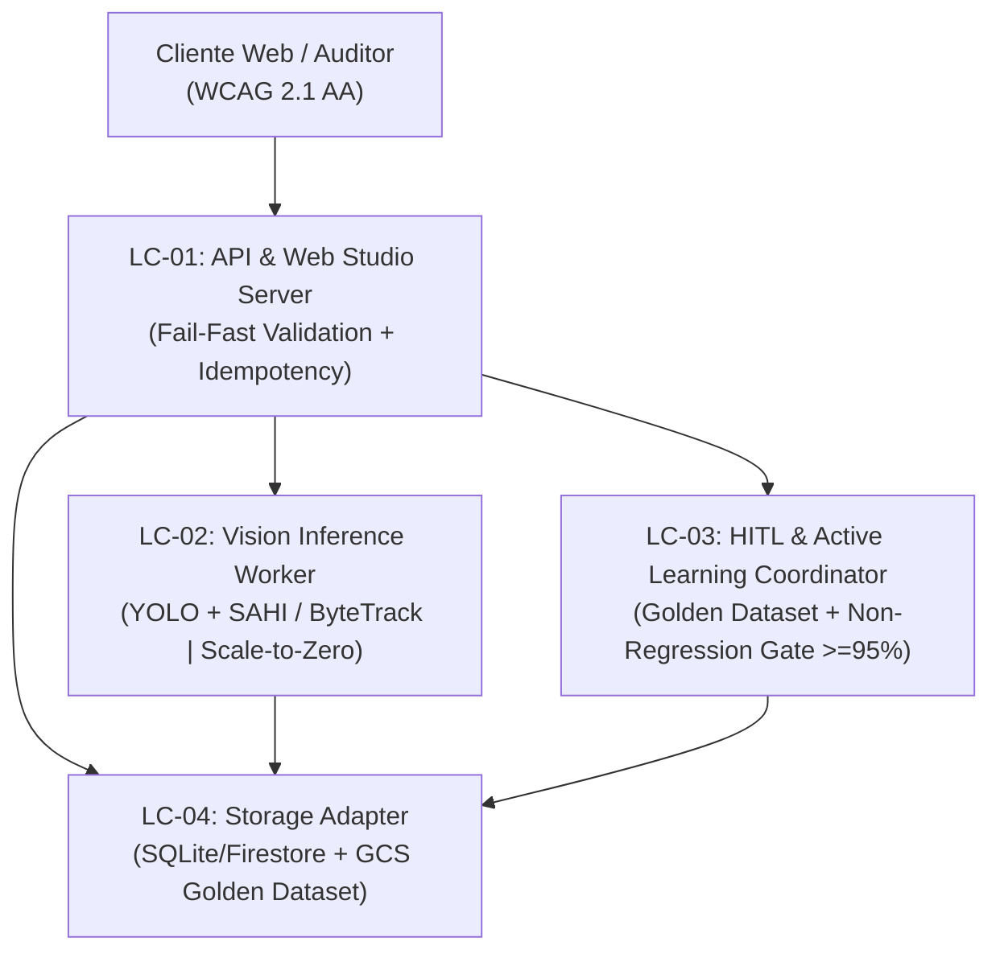

# Inventário de Componentes Lógicos de Infraestrutura e Domínios de Falha (Logical Components — `u1-agrocount-platform`)

Elaborado a partir de `nfr-requirements/performance-requirements.md` (`performance-requirements.md`), `nfr-requirements/security-requirements.md` (`security-requirements.md`), `nfr-requirements/scalability-requirements.md` (`scalability-requirements.md`), `nfr-requirements/reliability-requirements.md` (`reliability-requirements.md`), `nfr-requirements/observability-requirements.md` (`observability-requirements.md`), `nfr-requirements/tech-stack-decisions.md` (`tech-stack-decisions.md`), `functional-design/functional-spec.md` (`functional-spec.md`) e `contract-design/contract-summary.md` (`contract-summary.md`).

## 1. Mapeamento de Componentes Lógicos e Domínios de Falha (Blast Radius)

| Componente Lógico | Responsabilidade Técnica | Domínio de Falha / Blast Radius | Padrões NFR Aplicados |
|---|---|---|---|
| **LC-01: API Gateway & Web Studio Server** | Serve a interface web responsiva (`WebReviewStudioComponent`) e expõe os endpoints REST `/api/v1/*` | Isolado por requisição; falhas de validação retornam HTTP `400` sem afetar outras sessões | Validação pré-GPU fail-fast (`NFR2.2`), sanitização de entrada (`NFR6.1`), WCAG 2.1 AA (`NFR5.1`) |
| **LC-02: Vision Inference Worker (`CattleVisionEngineComponent`)** | Executa fatiamento SAHI para fotos 4K e rastreamento ByteTrack para vídeos | Isolado por `DetectionRun`; falha em mídia corrompida marca apenas aquela `Inspection` como `failed` | Execução *scale-to-zero* (`NFR3.1`), SLA $\le 5\text{s}$ foto / $\le 90\text{s}$ vídeo (`NFR2.1`), acurácia $\ge 95\%$ (`NFR1.1`) |
| **LC-03: HITL & Active Learning Coordinator (`HitlActiveLearningComponent`)** | Gera rótulos YOLO `.txt` + proveniência `.json` no *Golden Dataset* e executa *fine-tuning* com validação | Isolado do modelo ativo via avaliação em sombra (*shadow evaluation*) e troca atômica de ponteiro | Idempotência por chave (`NFR4.1`), trava de não-regressão $\ge 95\%$ (`NFR1.2`, `NFR4.2`) |
| **LC-04: Transactional & Object Storage Adapter** | Persistência SQLite/Firestore e buckets de mídia e *Golden Dataset* | Transações ACID por operação e prefixos imutáveis `samples/{sample_id}/` | Particionamento sem contenção (`NFR3.2`), checksum `SHA-256` em laudos |

---

## 2. Diagrama de Isolamento e Fluxo entre Componentes Lógicos

