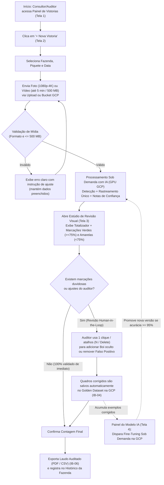

# Fluxo do Usuário e Jornadas de Interação (User Flow)

Mapeamento dos fluxos principais, pontos de decisão e caminhos de recuperação de erro do MVP, alinhado a `intent-capture/intent-statement.md` (`intent-statement.md`), `scope-definition/scope-document.md` (`scope-document.md`), `scope-definition/intent-backlog.md` (`intent-backlog.md`) e `rough-mockups-questions.md`.

## Sources

- [desc] Initial description: "criar uma aplicação com IA de contagem de bois"
- [scope] Workflow-selected scope: `mvp`.
- [Q1] Resposta à pergunta Q1 em `rough-mockups-questions.md`: `A` — Estrutura em 4 visões principais: Painel de Vistorias, Nova Vistoria (Upload/GCP), Estúdio de Revisão Visual e Human-in-the-Loop, e Painel do Modelo IA.
- [Q2] Resposta à pergunta Q2 em `rough-mockups-questions.md`: `A` — Estúdio interativo em tela dividida (*Split-Screen*) com caixas de alta confiança ($\ge 75\%$) vs. duvidosas, ajustes de 1 clique e botão para salvar no *Golden Dataset* (HITL) na GCP.
- [Q3] Resposta à pergunta Q3 em `rough-mockups-questions.md`: `A` — Web responsivo priorizando Desktop/Notebook e Tablet, com suporte móvel para consulta de laudos.
- [Q4] Resposta à pergunta Q4 em `rough-mockups-questions.md`: `A` — Conformidade WCAG 2.1 AA e atalhos de teclado para revisão rápida.

## Visão Geral do Fluxo Principal (Happy Path + Human-in-the-Loop)



**Equivalente em texto / ASCII do fluxo principal:**
```
[Tela 1: Painel] ---> [Tela 2: Nova Vistoria (Fazenda/Piquete + Upload/GCP <= 500 MB)]
                              |
                              v
                 [Análise IA Sob Demanda na GCP]
                              |
                              v
         [Tela 3: Estúdio de Revisão e Human-in-the-Loop]
            |                                       |
  (Sem correções)                         (Com ajuste manual 1-clique)
            |                                       |
            |                             [Salva quadro corrigido no]
            |                             [Golden Dataset na GCP    ] ---> [Tela 4: Fine-Tuning IA]
            +-------------------+-------------------+
                                |
                                v
             [Exportação de Laudo Auditado (PDF / CSV)]
```

---

## Fluxo 1: Vistoria Aérea, Revisão Visual e Emissão de Laudo (`IB-01`, `IB-02`, `IB-03`, `IB-05`, `IB-06`)

- **Persona:** Consultor agropecuário, técnico ou auditor rural (`intent-statement.md`).
- **Gatilho:** Necessidade de contabilizar um lote bovino após voo de drone sobre pasto ou piquete [desc] [Q1].
- **Passos Detalhados:**
  1. **Painel Inicial (Tela 1) $\rightarrow$ Ação do Usuário:** Clica em `[+ Nova Vistoria]` $\rightarrow$ **Resposta do Sistema:** Abre o formulário da Tela 2 com a última Fazenda visitada pré-selecionada como sugestão [Q1].
  2. **Identificação e Mídia (Tela 2) $\rightarrow$ Ação do Usuário:** Escolhe Fazenda, Piquete e Data; seleciona arquivo local (foto 1080p–4K ou vídeo até 500 MB) ou importa do Google Cloud Storage e clica em `[Iniciar Contagem com IA]` $\rightarrow$ **Resposta do Sistema:** Valida formato e tamanho, transfere para o armazenamento na GCP e exibe progresso em 3 etapas com tempo estimado (`scope-document.md`) [Q1].
  3. **Inspeção no Estúdio (Tela 3) $\rightarrow$ Ação do Usuário:** Visualiza o total contado pela IA e analisa as marcações na imagem/vídeo (verdes sólidas para confiança $\ge 75\%$; amarelas tracejadas com ícone `!` para casos duvidosos entre $25\%$ e $74\%$) $\rightarrow$ **Resposta do Sistema:** Destaca na coluna lateral a lista rápida de quadros/animais duvidosos para revisão imediata [Q2] [Q4].
  4. **Ajuste *Human-in-the-Loop* (Tela 3) $\rightarrow$ Ação do Usuário:** Clica em `[Ir]` em um item duvidoso (ou usa as `Setas` do teclado); clica em `[Remover]` (`Delete`) caso seja um falso positivo (ex.: cupinzeiro/pedra) ou usa `[+ Adicionar Boi]` (`N`) para marcar um animal sob sombra $\rightarrow$ **Resposta do Sistema:** Atualiza o totalizador na hora e empacota o quadro corrigido para o *Golden Dataset* na GCP (`intent-backlog.md` `IB-04`) [Q2] [Q4].
  5. **Conclusão e Exportação (Tela 3) $\rightarrow$ Ação do Usuário:** Clica em `[Salvar e Alimentar IA (HITL)]` e em `[Exportar PDF]` ou `[Exportar CSV]` $\rightarrow$ **Resposta do Sistema:** Salva a vistoria auditada no histórico da Fazenda/Piquete e baixa o laudo pronto para entrega ao cliente [Q1] [Q2].
- **Resultado de Sucesso:** O consultor obtém a contagem auditada e o laudo em poucos minutos, enquanto o modelo coleta automaticamente exemplos reais de campo para evoluir sua precisão [Q1] [Q2].

---

## Fluxo 2: Melhoria Contínua do Modelo via *Human-in-the-Loop* (`IB-04`)

- **Persona:** Líder técnico / Administrador do produto (`intent-statement.md`).
- **Gatilho:** Acúmulo de novos quadros corrigidos pelos auditores no *Golden Dataset* na GCP [Q1] [Q2].
- **Passos Detalhados:**
  1. **Painel do Modelo IA (Tela 4) $\rightarrow$ Ação do Usuário:** Acessa a aba `[Modelo IA]` na barra superior $\rightarrow$ **Resposta do Sistema:** Exibe a versão atual do modelo, a acurácia aferida (meta $\ge 95\%$) e a quantidade de novos quadros corrigidos acumulados desde o último treinamento [Q1].
  2. **Disparo do Ajuste Fino (Tela 4) $\rightarrow$ Ação do Usuário:** Clica em `[Acionar Fine-Tuning Sob Demanda (GPU GCP)]` $\rightarrow$ **Resposta do Sistema:** Inicia a tarefa de treinamento sob demanda na GCP combinando o dataset base com os novos *Hard Examples* revisados pelos auditores e exibe o status de execução [Q1] [Q2].
  3. **Validação e Promoção Automática $\rightarrow$ Resposta do Sistema:** Ao concluir o *fine-tuning*, o sistema avalia a nova versão contra o conjunto de validação de referência; se a acurácia se mantiver $\ge 95\%$ e superar/igualar a versão anterior, ativa a nova versão e registra o ganho no histórico da Tela 4 (`intent-backlog.md` `IB-04`) [Q1] [Q2].

---

## Caminhos de Erro e Recuperação (Error & Recovery Paths)

| Condição de Exceção | Mensagem / Tela Apresentada | Ação de Recuperação Oferecida ao Usuário |
|---|---|---|
| **Arquivo acima de 500 MB ou formato não suportado** | Alerta inline na Tela 2 informando o tamanho/formato detectado e o limite do MVP (`500 MB` / `.JPG, .PNG, .MP4, .MOV`). | Selecionar outro arquivo, importar clipe recortado ou escolher do bucket GCP sem perder Fazenda/Piquete preenchidos [Q1]. |
| **Interrupção de internet durante o upload** | Indicador de pausa na barra de envio (*"Conexão instável detectada"*). | Botão `[Retomar Envio]` ou opção de importar diretamente de link/bucket na GCP [Q1]. |
| **Vídeo com baixa nitidez ou excesso de oclusão** | Aviso amarelo no topo da Tela 3 destacando que uma parcela elevada das detecções ficou na faixa duvidosa ($< 75\%$). | Filtro rápido para revisar os quadros duvidosos com atalhos de teclado ou substituir o vídeo por um sobrevoo mais baixo/nítido [Q2] [Q4]. |
| **Desfazer edição acidental no Canvas HITL** | Se o auditor remover ou adicionar uma marcação por engano na Tela 3. | Botão `[Desfazer (Ctrl+Z)]` imediato no topo do canvas, restaurando a marcação e o contador anterior [Q2] [Q4]. |

## Assumptions & Open Questions

- **Premissa UFL-A01 (Fluxo contínuo sem perda de contexto):** Assume-se que todas as correções feitas na Tela 3 são salvas como rascunho automaticamente a cada clique, evitando perda de trabalho caso o navegador do auditor seja fechado antes de exportar o PDF [assumption] [Q2].
- **Premissa UFL-A02 (Acesso ao painel de re-treinamento):** Assume-se que a Tela 4 (disparo de *Fine-Tuning* na GCP) fica visível ao perfil administrador/líder do projeto, enquanto todos os consultores/auditores contribuem automaticamente para o *Golden Dataset* ao revisar suas vistorias na Tela 3 [assumption] [Q1] [Q2].
