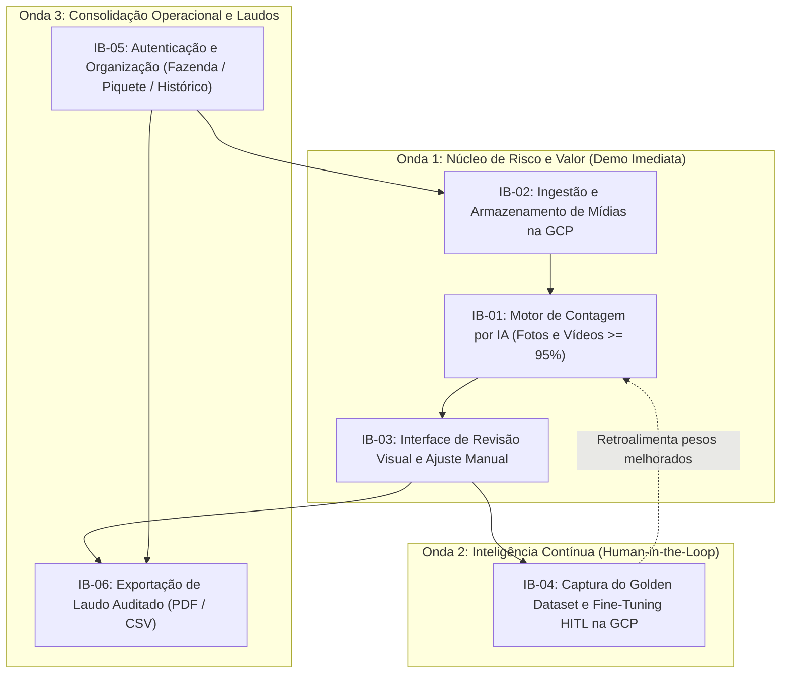

# Backlog de Intenção Priorizado (Intent Backlog)

Backlog de capacidades de alto nível (*proto-Units*) priorizado pelos métodos **MoSCoW** e **RICE**, rastreado a `intent-capture/intent-statement.md` (`intent-statement.md`), `feasibility/feasibility-assessment.md` (`feasibility-assessment.md`), `feasibility/constraint-register.md` (`constraint-register.md`) e `scope-definition-questions.md`.

## Sources

- [desc] Initial description: "criar uma aplicação com IA de contagem de bois"
- [scope] Workflow-selected scope: `mvp`.
- [Q1] Resposta à pergunta Q1 em `scope-definition-questions.md`: `A` — Jornada completa de vistoria: upload/importação via GCP, contagem com IA, visualização demarcada, totalizador e exportação PDF/CSV.
- [Q2] Resposta à pergunta Q2 em `scope-definition-questions.md`: `A` — Must-Have: revisão/ajuste manual na tela, indicador de confiança e ciclo *Human-in-the-Loop (Active Learning)* na GCP; Should/Could-Have: classificação por categoria/idade e georreferenciamento GPS.
- [Q3] Resposta à pergunta Q3 em `scope-definition-questions.md`: `A` — Login simples e organização por Fazenda / Piquete (Lote) / Data da Vistoria com histórico na GCP.
- [Q4] Resposta à pergunta Q4 em `scope-definition-questions.md`: `A` — Sequenciamento *Risk-first + Value-first*.
- [Q5] Resposta à pergunta Q5 em `scope-definition-questions.md`: `A` — Foco imediato no fluxo central para demonstrações comerciais a parceiros.

## Critérios de Priorização (MoSCoW + RICE)

A pontuação **RICE** foi calculada como $\text{RICE} = \frac{\text{Alcance (Reach)} \times \text{Impacto (Impact)} \times \text{Confiança (Confidence)}}{\text{Esforço Relativo (Effort)}}$, onde:
- **Alcance (Reach):** Percentual das vistorias/demonstrações impactadas ($100 = 100\%$ das vistorias do MVP).
- **Impacto (Impact):** Escala padrão ($3 = \text{Massivo}$, $2 = \text{Alto}$, $1 = \text{Médio}$, $0{,}5 = \text{Baixo}$).
- **Confiança (Confidence):** Grau de certeza apoiado em `feasibility-assessment.md` ($100\% = \text{Alta}$, $90\% = \text{Média-Alta}$, $80\% = \text{Média}$).
- **Esforço Relativo (Effort):** Pontos relativos de esforço de construção ($1 = \text{Baixo}$ a $5 = \text{Alto}$).

## Tabela do Backlog Priorizado (Proto-Units)

| ID | Proto-Unit (Capacidade de Produto) | Categoria MoSCoW | Alcance | Impacto | Confiança | Esforço | Score RICE | Rastreabilidade (`intent-statement.md` / `constraint-register.md`) |
|---|---|---|---|---|---|---|---|---|
| **IB-01** | **Motor de Contagem Aérea por IA (Fotos e Vídeos):** Detecção em fotos de alta resolução (1080p–4K) e rastreamento único de bovinos em vídeos curtos (até 3–5 min) sob demanda na GCP para atingir $\ge 95\%$ de acurácia, acompanhado de nota de confiança por detecção. | **Must Have** | 100 | 3 | 90% | 3 | **90,0** | `intent-statement.md` (Meta $\ge 95\%$), `CON-T01`, `CON-T02`, `CON-T04` [desc] [Q1] [Q2] [Q4] |
| **IB-02** | **Ingestão e Armazenamento de Mídias de Drone na GCP:** Upload resiliente pela aplicação web e importação/armazenamento em nuvem (Google Cloud Storage) com validação de formato, resolução e limite de 500 MB / 5 min. | **Must Have** | 100 | 3 | 100% | 2 | **150,0** | `CON-T01`, `CON-T03`, `CON-T05` [Q1] [Q3] |
| **IB-03** | **Interface de Revisão Visual e Correção Assistida (Auditor UI):** Reprodutor/visualizador web exibindo os animais demarcados por cor de confiança (alta vs. duvidosa) e permitindo ao auditor adicionar falsos negativos ou remover falsos positivos com atualização imediata da contagem. | **Must Have** | 100 | 3 | 90% | 2 | **135,0** | `intent-statement.md` (Redução de retrabalho), `CON-T02`, `CON-T05` [Q1] [Q2] |
| **IB-04** | **Ciclo *Human-in-the-Loop (HITL)* e Pipeline de Melhoria Contínua do Modelo:** Captura automática dos quadros/imagens corrigidos pelo auditor (e detecções limítrofes confirmadas) em um *Golden Dataset* estruturado na GCP, com rotina sob demanda de ajuste fino (*fine-tuning*) e avaliação de evolução de acurácia do modelo. | **Must Have** | 100 | 3 | 90% | 3 | **90,0** | `intent-statement.md` (Meta $\ge 95\%$), `CON-T02`, `CON-T03`, `CON-T04` [Q2] [Q4] |
| **IB-05** | **Gestão de Vistorias, Fazendas/Piquetes e Autenticação:** Login simples do consultor/auditor e organização estruturada de cada análise por Fazenda, Piquete (Lote) e Data da Vistoria, com histórico consultável das execuções. | **Must Have** | 100 | 2 | 100% | 2 | **100,0** | `intent-statement.md` (Público-alvo: consultorias/auditores) [Q3] |
| **IB-06** | **Emissão e Exportação de Laudos Auditados (PDF / CSV):** Geração de relatório de vistoria com cabeçalho da Fazenda/Piquete, data/hora, contagem da IA, registro de revisão *Human-in-the-Loop*, total final validado e quadro visual demarcado. | **Must Have** | 100 | 2 | 100% | 1,5 | **133,3** | `intent-statement.md` (Emissão de laudos de rebanho) [Q1] |
| **IB-07** | **Classificação Visual por Categoria/Faixa Etária (Bezerros vs. Adultos):** Diferenciação opcional de porte/categoria dos animais durante a detecção aérea. | **Should Have** *(Pós-MVP)* | 60 | 1 | 80% | 3 | **16,0** | Evolução pós-validação inicial [Q2] |
| **IB-08** | **Mapeamento Georreferenciado (Metadados GPS do Drone):** Leitura de coordenadas de telemetria das mídias para plotar a localização de cada piquete/contagem em mapa interativo. | **Could Have** *(Pós-MVP)* | 50 | 1 | 80% | 3 | **13,3** | Evolução pós-validação inicial [Q2] |

## Sequenciamento e Dependências entre Capacidades (Risk-First + Value-First)

Seguindo a diretriz confirmada em `scope-definition-questions.md` [Q4] [Q5], a construção e validação obedecem à estratégia **Risco e Valor Primeiro (*Risk-first + Value-first*)**, dividida em 3 ondas incrementais dentro do MVP:

1. **Onda 1 — Núcleo de Risco Técnico e Demonstração Comercial (`IB-02` $\rightarrow$ `IB-01` $\rightarrow$ `IB-03`):**
   - Ataca imediatamente o maior risco técnico apontado em `feasibility-assessment.md` (precisão $\ge 95\%$ em fotos e vídeos sem dupla contagem) e entrega a tela visual de revisão demarcada para demonstrações comerciais [Q1] [Q4] [Q5].
2. **Onda 2 — Ciclo *Human-in-the-Loop* e Aprendizado Ativo (`IB-04` conectado a `IB-03` e `IB-01`):**
   - Conecta os ajustes feitos pelo humano na interface (`IB-03`) ao armazenamento de exemplos difíceis (*Hard Examples*) na GCP e à rotina de ajuste fino (*fine-tuning*) do modelo (`IB-01`), garantindo evolução contínua de acurácia a baixo custo [Q2] [Q4].
3. **Onda 3 — Organização de Vistorias e Emissão de Laudos (`IB-05` + `IB-06`):**
   - Consolida o controle de acesso do consultor, a estruturação por Fazenda/Piquete/Data e a geração dos relatórios oficiais em PDF e CSV para uso operacional completo pelas consultorias e auditores [Q1] [Q3] [Q4].

## Assumptions & Open Questions

- **Premissa BKL-A01 (Critério de promoção de modelo no IB-04):** Assume-se que toda nova versão do modelo gerada pelo ciclo *Human-in-the-Loop* (`IB-04`) só substituirá a versão anterior após comprovar manutenção ou ganho de acurácia sobre o conjunto de validação de referência ($\ge 95\%$) [assumption] [Q2].
- **Premissa BKL-A02 (Itens Pós-MVP):** Os itens `IB-07` (classificação etária) e `IB-08` (mapa GPS) permanecem documentados no backlog para versões futuras, não bloqueando a aprovação e entrega das Unidades `Must Have` (`IB-01` a `IB-06`) [assumption] [Q2].
