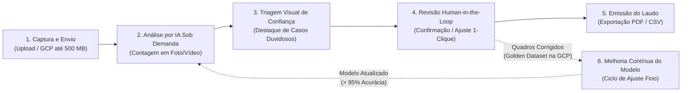

# Documento de Definição de Escopo (Scope Document)

Definido a partir de `intent-capture/intent-statement.md` (`intent-statement.md`), `feasibility/feasibility-assessment.md` (`feasibility-assessment.md`), `feasibility/constraint-register.md` (`constraint-register.md`) e das decisões confirmadas em `scope-definition-questions.md`.

## Sources

- [desc] Initial description: "criar uma aplicação com IA de contagem de bois"
- [scope] Workflow-selected scope: `mvp`.
- [Q1] Resposta à pergunta Q1 em `scope-definition-questions.md`: `A` — Fluxo completo de vistoria: envio/importação de foto ou vídeo curto de drone (via upload ou GCP), execução da contagem com IA, visualização do vídeo/imagem com os bois demarcados na tela, totalizador da contagem e exportação de laudo/resumo (PDF/CSV).
- [Q2] Resposta à pergunta Q2 em `scope-definition-questions.md`: `A` — Must-Have: revisão/ajuste manual rápido da contagem pelo auditor na tela, indicador de confiança da análise e ciclo *Human-in-the-Loop (Active Learning)* salvando exemplos corrigidos no GCP para melhoria contínua do modelo; Should/Could-Have: classificação por categoria/idade do animal e integração com mapas/georreferenciamento (GPS do drone).
- [Q3] Resposta à pergunta Q3 em `scope-definition-questions.md`: `A` — Login simples do consultor/auditor e organização básica de cada análise por Fazenda / Piquete (Lote) / Data da Vistoria, mantendo o histórico no GCP.
- [Q4] Resposta à pergunta Q4 em `scope-definition-questions.md`: `A` — Sequenciamento *Risk-first + Value-first* (validar primeiro o núcleo de visão computacional com $\ge 95\%$ de acurácia e visualização demarcada em interface web enxuta, seguido por organização de vistorias e exportação de laudo).
- [Q5] Resposta à pergunta Q5 em `scope-definition-questions.md`: `A` — Marco prioritário de curto prazo focado em disponibilizar o fluxo central para demonstrações comerciais a parceiros com senso de urgência comercial.

## Fronteira do Escopo Mínimo Viável (In-Scope vs. Out-of-Scope)

O objetivo do MVP (`mvp`) é entregar uma solução web enxuta, auditável e financeiramente eficiente sob demanda no ecossistema Google Cloud Platform (GCP), capaz de atingir acurácia igual ou superior a 95% na contagem de bois em mídias aéreas nítidas (`intent-statement.md`, `feasibility-assessment.md`) e evoluir continuamente com as correções dos auditores (*Human-in-the-Loop*) [desc] [scope] [Q1] [Q2].

| Classificação | Capacidade / Item de Escopo | Justificativa e Alinhamento (`intent-statement.md` / `constraint-register.md`) |
|---|---|---|
| **DENTRO DO ESCOPO (Must-Have — v1)** | **1. Envio e Importação de Mídias de Drone (Upload e GCP):** Recebimento de fotos aéreas em alta resolução (1080p–4K) e vídeos curtos (até 3–5 min / até 500 MB) via navegador ou importação do armazenamento em nuvem na GCP (`CON-T01`, `CON-T03`). | Habilita o ponto de partida da vistoria do consultor agropecuário sem travamentos de transferência [Q1]. |
| **DENTRO DO ESCOPO (Must-Have — v1)** | **2. Contagem Automatizada por IA em Fotos e Vídeos:** Detecção de bovinos em imagens estáticas e rastreamento contínuo de animais únicos ao longo de vídeos de sobrevoo, executados sob demanda com aceleração gráfica na GCP (`CON-T02`, `CON-T04`). | Entrega a meta central de $\ge 95\%$ de acurácia em mídias nítidas com custo proporcional ao uso [desc] [Q1] [Q4]. |
| **DENTRO DO ESCOPO (Must-Have — v1)** | **3. Visualização Demarcada e Indicador de Confiança:** Exibição das marcações sobre cada animal contabilizado, diferenciando visualmente detecções de alta confiança das detecções limítrofes/duvidosas (ex.: animais sob sombra ou agrupados). | Reduz drasticamente o tempo de conferência visual do auditor e dá transparência ao resultado da IA [Q1] [Q2]. |
| **DENTRO DO ESCOPO (Must-Have — v1)** | **4. Revisão Assistida e Ciclo *Human-in-the-Loop (HITL)*:** Permissão para o auditor adicionar animais não detectados (falsos negativos) ou remover marcações incorretas (falsos positivos) diretamente na tela, salvando automaticamente os quadros corrigidos em um conjunto curado na GCP para re-treinamento/ajuste fino do modelo. | Garante 100% de confiabilidade no laudo final entregue ao cliente e melhora a precisão do modelo a cada vistoria realizada [Q2]. |
| **DENTRO DO ESCOPO (Must-Have — v1)** | **5. Organização de Vistorias e Autenticação Simples:** Acesso autenticado do consultor/auditor e organização das contagens por **Fazenda $\rightarrow$ Piquete (Lote) $\rightarrow$ Data da Vistoria**, com histórico consultável. | Permite gerenciar laudos de diferentes propriedades rurais atendidas pela consultoria [Q3]. |
| **DENTRO DO ESCOPO (Must-Have — v1)** | **6. Exportação de Laudo / Resumo da Vistoria (PDF e CSV):** Geração de documento sintético com dados da propriedade/piquete, data, contagem automática da IA, ajustes do auditor, contagem final consolidada e imagem representativa demarcada. | Materializa o entregável de trabalho de consultorias, técnicos e auditores rurais (`intent-statement.md`) [Q1]. |
| **DESEJÁVEL FUTURO (Should / Could-Have — Pós-MVP)** | **7. Classificação por Categoria/Idade e Georreferenciamento (GPS):** Distinção visual entre bezerros e animais adultos e plotagem das coordenadas GPS do drone em mapa interativo da fazenda. | Agrega valor analítico adicional, mas não é pré-requisito para validar a contagem principal no MVP [Q2]. |
| **FORA DO ESCOPO (Won't-Have nesta versão)** | **8. Câmeras Fixas Contínuas (IP/RTSP 24/7) e App Móvel Nativo Offline:** Monitoramento ininterrupto por vídeo em tempo real e aplicativo instalado para execução sem internet no meio do pasto (`CON-T05`). | Excluídos explicitamente em `intent-statement.md` para manter foco, velocidade de entrega e baixo custo operacional [scope]. |
| **FORA DO ESCOPO (Won't-Have nesta versão)** | **9. Gestão Corporativa Multi-Tenant Complexa, Faturamento Automático e Integração com ERPs/Brincos RFID:** Hierarquias complexas de permissão, cobrança automatizada de cartão e leitura de brincos eletrônicos. | Desnecessários para as demonstrações comerciais e primeiras vistorias assistidas [Q1] [Q2] [Q3]. |

## Mapa de Fluxo de Valor (Value Stream Map)

O diagrama abaixo conecta cada etapa da jornada do consultor/auditor no MVP ao resultado de negócio e ao ciclo de aprendizado contínuo (*Human-in-the-Loop*):

**Equivalente em texto do fluxo de valor:**
1. **Captura e Envio:** O consultor seleciona a Fazenda e o Piquete e envia a foto (1080p–4K) ou vídeo curto (até 3–5 min / 500 MB) via upload web ou importação da GCP [Q1] [Q3].
2. **Análise por IA Sob Demanda:** O motor de visão computacional processa a mídia sob demanda com aceleração gráfica na GCP, contabilizando os animais sem dupla contagem entre quadros [Q1] [Q4].
3. **Triagem Visual de Confiança:** A interface apresenta o total contado e destaca visualmente tanto as detecções de alta certeza quanto os pontos de menor confiança (ex.: sombras e aglomerações) [Q2].
4. **Revisão *Human-in-the-Loop*:** O auditor valida o resultado ou corrige pontualmente falsos positivos/negativos na tela em poucos segundos [Q2].
5. **Emissão do Laudo:** O sistema gera o relatório auditado (PDF/CSV) pronto para entrega ao produtor rural ou contratação de auditoria [Q1].
6. **Melhoria Contínua do Modelo:** As correções feitas pelo auditor no passo 4 alimentam automaticamente a base curada na GCP para ciclos periódicos de ajuste fino do modelo, elevando progressivamente a acurácia em cenários reais de campo [Q2].

## Validação de Escopo versus Prazo e Restrições

- **Coerência com o prazo acelerado (`CON-O01`):** A escolha pela estratégia *Risk-first + Value-first* [Q4] garante que o núcleo demonstrável a parceiros comerciais (envio de mídia $\rightarrow$ contagem automática com $\ge 95\%$ de acurácia $\rightarrow$ visualização demarcada e ajuste *Human-in-the-Loop*) seja construído e validado logo na primeira entrega funcional, sem ficar bloqueado por cadastros secundários [Q4] [Q5].
- **Coerência com o modelo de custos sob demanda (`CON-O02`, `CON-T03`, `CON-T04`):** Tanto a inferência em vídeos curtos quanto o ciclo de re-treinamento *Human-in-the-Loop* operam por acionamento sob demanda na GCP, mantendo o custo próximo de zero quando ocioso e evitando infraestrutura ligada permanentemente (`feasibility-assessment.md`) [Q1] [Q2] [Q5].

## Assumptions & Open Questions

- **Premissa SCP-A01 (Acionamento controlado do re-treinamento HITL):** Assume-se que, no MVP, a coleta dos quadros corrigidos pelos auditores ocorre de forma 100% automática a cada revisão salva, enquanto o disparo do re-treinamento (*fine-tuning*) do modelo na GCP ocorrerá em lotes controlados (sob aprovação do líder do projeto ou ao atingir um volume mínimo de novos exemplos revisados) para assegurar validação de qualidade antes de atualizar o modelo em uso [assumption] [Q2].
- **Premissa SCP-A02 (Foco do laudo exportado):** Assume-se que o layout padrão de exportação em PDF/CSV contendo identificação da Fazenda/Piquete, data/hora, contagem da IA, ajustes manuais do auditor, total consolidado e imagem demarcada atende às demonstrações comerciais e vistorias iniciais [assumption] [Q1] [Q3].
