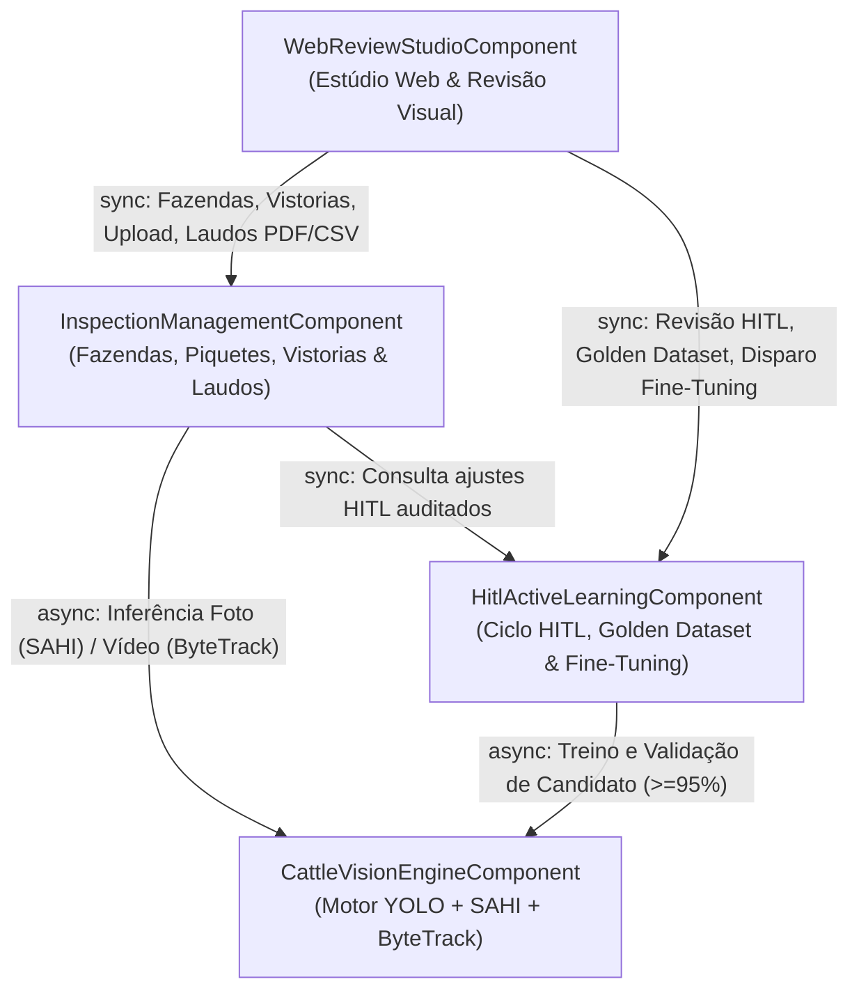

# Catálogo de Componentes de Domínio (Domain Design Components)

Elaborado a partir de `requirements-analysis/requirements.md` (`requirements.md`), `user-stories/stories.md` (`stories.md`), `practices-discovery/team-practices.md` (`team-practices.md`) e `domain-design-questions.md` [Q1].

## Catálogo Legível por Máquina (Machine-Readable Component Catalogue)

```yaml
components:
  - name: WebReviewStudioComponent
    summary: Interface web responsiva para gestão de vistorias, upload de mídias de drone, estúdio de revisão visual Human-in-the-Loop e painel de evolução do modelo.
    behaviour: >
      Renderiza as 4 telas da aplicação (Painel de Vistorias, Nova Vistoria, Estúdio de Revisão Split-Screen e Painel de Evolução do Modelo IA), aplica validação prévia de formato/tamanho no cliente, gerencia o canvas interativo com tripla codificação acessível (cor + borda + ícone) e atalhos de teclado (Setas, Espaço, Delete, N), recalcula instantaneamente a contagem auditada e consome os contratos REST dos componentes de gestão e aprendizado ativo.
    responsibilities:
      - Renderizar o Painel de Fazendas, Piquetes e Histórico de Vistorias com filtros e paginação
      - Validar previamente arquivos de foto e vídeo e conduzir o fluxo de upload/importação GCP
      - Exibir o canvas interativo de bounding boxes com fila lateral de triagem de baixa confiança (0.25-0.74)
      - Capturar adições de falsos negativos (+FN) e remoções de falsos positivos (-FP) e submeter o lote de revisão HITL
      - Exibir o Painel de Evolução do Modelo IA e acionar o fine-tuning sob demanda
    depends_on:
      - component: InspectionManagementComponent
        interaction: Consulta e cadastra fazendas, piquetes e vistorias, envia mídias e solicita exportação de laudos PDF/CSV
        style: sync
      - component: HitlActiveLearningComponent
        interaction: Submete revisões Human-in-the-Loop para o Golden Dataset, consulta métricas do modelo e dispara fine-tuning sob demanda
        style: sync
    dependents: []
    external_dependencies: []
    entities:
      - name: ReviewSessionState
        identifier: sessionId
        attributes: [sessionId, inspectionId, activeTool, selectedBoxId, zoomLevel, pendingAdditions, pendingRemovals, dirtyFlag]
        references:
          - entity: Inspection
            owned_by: InspectionManagementComponent
            relationship: cada ReviewSessionState referencia uma Inspection em revisão ativa na tela

  - name: InspectionManagementComponent
    summary: Gerencia o cadastro de Fazendas e Piquetes, o ciclo de vida das Vistorias aéreas, a validação de ingestão de mídia e a geração de laudos auditados PDF/CSV.
    behaviour: >
      Autentica o consultor/auditor, mantém o cadastro hierárquico de Fazendas e Piquetes, aplica regras estritas de validação de mídia pré-GPU (formatos .jpg/.jpeg/.png até 50 MB e .mp4/.mov até 500 MB / 5 min), garante idempotência na criação de vistorias, coordena o disparo de inferência junto ao CattleVisionEngineComponent, sincroniza contagens revisadas com o HitlActiveLearningComponent e gera os laudos oficiais em PDF e CSV.
    responsibilities:
      - Gerenciar o ciclo de vida de Fazendas (Farm) e Piquetes (Paddock)
      - Controlar a máquina de estados da Vistoria (pending, processing, needs_review, reviewed, failed)
      - Validar formato, integridade e tamanho de fotos e vídeos antes de alocar GPU
      - Consolidar a contagem bruta da IA e a contagem final auditada após revisão humana
      - Gerar e exportar relatórios auditados em formato PDF e CSV
    depends_on:
      - component: CattleVisionEngineComponent
        interaction: Dispara a execução de detecção/rastreamento de bovinos para a mídia validada da vistoria
        style: async
      - component: HitlActiveLearningComponent
        interaction: Registra e consulta os ajustes Human-in-the-Loop consolidados para compor o laudo auditado
        style: sync
    dependents:
      - component: WebReviewStudioComponent
        interaction: Consulta e cadastra fazendas, piquetes e vistorias, envia mídias e solicita exportação de laudos PDF/CSV
    external_dependencies:
      - name: OperationalDatabase
        kind: database
        purpose: Persistência transacional de fazendas, piquetes, vistorias e relatórios
      - name: DroneMediaObjectStore
        kind: object-store
        purpose: Armazenamento de fotos 4K e vídeos de drone no Google Cloud Storage
    entities:
      - name: Farm
        identifier: farmId
        attributes: [farmId, name, municipality, stateUf, ownerName, notes, createdAt]
      - name: Paddock
        identifier: paddockId
        attributes: [paddockId, farmId, name, areaHectares, notes, createdAt]
        references:
          - entity: Farm
            owned_by: InspectionManagementComponent
            relationship: cada Paddock pertence a uma Farm
      - name: Inspection
        identifier: inspectionId
        attributes: [inspectionId, farmId, paddockId, auditorId, mediaType, mediaUri, mediaSizeBytes, status, rawAiCount, highConfidenceCount, uncertainCount, addedFnCount, removedFpCount, finalAuditedCount, avgConfidence, modelVersionUsed, idempotencyKey, createdAt, updatedAt]
        references:
          - entity: Farm
            owned_by: InspectionManagementComponent
            relationship: cada Inspection está vinculada a uma Farm
          - entity: Paddock
            owned_by: InspectionManagementComponent
            relationship: cada Inspection audita um Paddock específico
      - name: AuditReport
        identifier: reportId
        attributes: [reportId, inspectionId, format, generatedUri, checksumSha256, generatedBy, generatedAt]
        references:
          - entity: Inspection
            owned_by: InspectionManagementComponent
            relationship: cada AuditReport documenta o resultado auditado de uma Inspection

  - name: HitlActiveLearningComponent
    summary: Orquestra o ciclo Human-in-the-Loop (Active Learning), curadoria do Golden Dataset no padrão YOLO e fine-tuning sob demanda com trava de não-regressão (>= 95%).
    behaviour: >
      Recebe as correções realizadas pelo auditor no Estúdio de Revisão (falsos negativos adicionados, falsos positivos removidos e detecções duvidosas confirmadas), converte de forma idempotente as caixas validadas para o formato normalizado YOLO (class_id x_center y_center width height em [0, 1]), persiste o par imagem/rótulo mais manifesto JSON de proveniência no Golden Dataset (Google Cloud Storage) e coordena jobs sob demanda de fine-tuning, promovendo um modelo candidato somente se atingir acurácia >= 95% e não regredir frente ao modelo ativo.
    responsibilities:
      - Processar lotes de correção humana (+FN, -FP, confirmação de uncertain) com garantia de idempotência
      - Gerar arquivos de anotação normalizados no padrão YOLO e manifestos JSON de proveniência
      - Manter o catálogo do Golden Dataset no Google Cloud Storage
      - Executar o pipeline de fine-tuning sob demanda e avaliar candidatos via CattleVisionEngineComponent
      - Aplicar a trava de governança de promoção (acurácia >= 95% e não-regressão)
    depends_on:
      - component: CattleVisionEngineComponent
        interaction: Executa o treinamento/avaliação do modelo candidato contra o conjunto de validação de referência
        style: async
    dependents:
      - component: WebReviewStudioComponent
        interaction: Submete revisões Human-in-the-Loop para o Golden Dataset, consulta métricas do modelo e dispara fine-tuning sob demanda
      - component: InspectionManagementComponent
        interaction: Registra e consulta os ajustes Human-in-the-Loop consolidados para compor o laudo auditado
    external_dependencies:
      - name: GoldenDatasetObjectStore
        kind: object-store
        purpose: Repositório versionado de frames corrigidos, arquivos .txt YOLO e pesos de modelos no Google Cloud Storage
      - name: OperationalDatabase
        kind: database
        purpose: Registro de lotes de correção HITL, amostras curadas e histórico de versões de modelos
    entities:
      - name: HitlCorrectionBatch
        identifier: batchId
        attributes: [batchId, inspectionId, auditorId, modelVersionUsed, falseNegativesAdded, falsePositivesRemoved, uncertainConfirmed, finalCount, idempotencyKey, createdAt]
        references:
          - entity: Inspection
            owned_by: InspectionManagementComponent
            relationship: cada HitlCorrectionBatch registra a revisão humana de uma Inspection
      - name: GoldenDatasetSample
        identifier: sampleId
        attributes: [sampleId, batchId, inspectionId, imageUri, yoloLabelsUri, provenanceJsonUri,yoloAnnotationsText, boxCount, usedInTrainingVersion, createdAt]
        references:
          - entity: HitlCorrectionBatch
            owned_by: HitlActiveLearningComponent
            relationship: cada GoldenDatasetSample é gerada a partir de um HitlCorrectionBatch confirmado
      - name: ModelVersion
        identifier: versionId
        attributes: [versionId, versionTag, baseVersionTag, weightsUri, goldenSamplesCount, validationAccuracy, precisionScore, recallScore, status, promotedAt, createdAt]

  - name: CattleVisionEngineComponent
    summary: Motor de visão computacional para detecção em fotos aéreas de alta resolução (YOLO + SAHI) e rastreamento único em vídeos de drone (YOLO + ByteTrack).
    behaviour: >
      Executa sob demanda com aceleração gráfica (scale-to-zero) a inferência em fotos aéreas (1080p-4K) utilizando fatiamento SAHI (Slicing Aided Hyper Inference) com fusão NMS e a inferência quadro a quadro em vídeos de drone (.mp4/.mov) utilizando rastreamento multi-objeto ByteTrack para atribuir track_id único a cada bovino. Classifica cada detecção nas faixas de confiança high_confidence (>= 0.75) ou uncertain (0.25 a 0.74) e fornece rotinas de avaliação de acurácia para o ciclo de fine-tuning.
    responsibilities:
      - Executar inferência fatiada YOLO + SAHI em fotos aéreas estáticas de alta resolução
      - Executar detecção e rastreamento multi-objeto YOLO + ByteTrack em vídeos de drone sem dupla contagem
      - Categorizar detecções por limiar de confiança (high_confidence >= 0.75 vs. uncertain 0.25-0.74)
      - Extrair quadros representativos de vídeos para revisão humana no Estúdio Visual
      - Avaliar modelos candidatos durante o fine-tuning contra o dataset de validação
    depends_on: []
    dependents:
      - component: InspectionManagementComponent
        interaction: Dispara a execução de detecção/rastreamento de bovinos para a mídia validada da vistoria
      - component: HitlActiveLearningComponent
        interaction: Executa o treinamento/avaliação do modelo candidato contra o conjunto de validação de referência
    external_dependencies:
      - name: DroneMediaObjectStore
        kind: object-store
        purpose: Leitura de fotos/vídeos de entrada e gravação de quadros extraídos no Google Cloud Storage
      - name: GoldenDatasetObjectStore
        kind: object-store
        purpose: Leitura dos pesos ativos do modelo YOLO e amostras de treinamento/validação
    entities:
      - name: DetectionRun
        identifier: runId
        attributes: [runId, inspectionId, modelVersionTag, pipelineMode, processingTimeMs, rawCount, highConfidenceCount, uncertainCount, avgConfidence, representativeFrameUri, completedAt]
        references:
          - entity: Inspection
            owned_by: InspectionManagementComponent
            relationship: cada DetectionRun processa a mídia de uma Inspection
      - name: BoundingBoxDetection
        identifier: detectionId
        attributes: [detectionId, runId, inspectionId, frameIndex, timestampSec, trackId, classId, xCenter, yCenter, width, height, confidence, confidenceTier, reviewStatus]
        references:
          - entity: DetectionRun
            owned_by: CattleVisionEngineComponent
            relationship: cada BoundingBoxDetection pertence a um DetectionRun
```

---

## Diagrama de Componentes (Component Diagram)



**Equivalente em texto do grafo de componentes:**
- `WebReviewStudioComponent` $\xrightarrow{\text{sync}}$ `InspectionManagementComponent`
- `WebReviewStudioComponent` $\xrightarrow{\text{sync}}$ `HitlActiveLearningComponent`
- `InspectionManagementComponent` $\xrightarrow{\text{async}}$ `CattleVisionEngineComponent`
- `InspectionManagementComponent` $\xrightarrow{\text{sync}}$ `HitlActiveLearningComponent`
- `HitlActiveLearningComponent` $\xrightarrow{\text{async}}$ `CattleVisionEngineComponent`

---

## Resumo de Componentes (Component Summary)

| Component | Purpose | Depends On | Dependents | Entities Owned |
|---|---|---|---|---|
| `WebReviewStudioComponent` | Interface web responsiva para gestão de vistorias, upload, revisão visual *Human-in-the-Loop* e painel do modelo IA | `InspectionManagementComponent`, `HitlActiveLearningComponent` | — | `ReviewSessionState` |
| `InspectionManagementComponent` | Gestão de Fazendas/Piquetes, ciclo de vida de Vistorias, validação pré-GPU e exportação de laudos PDF/CSV | `CattleVisionEngineComponent`, `HitlActiveLearningComponent` | `WebReviewStudioComponent` | `Farm`, `Paddock`, `Inspection`, `AuditReport` |
| `HitlActiveLearningComponent` | Ciclo *Human-in-the-Loop*, exportação de rótulos YOLO para o *Golden Dataset* e *fine-tuning* com trava $\ge 95\%$ | `CattleVisionEngineComponent` | `WebReviewStudioComponent`, `InspectionManagementComponent` | `HitlCorrectionBatch`, `GoldenDatasetSample`, `ModelVersion` |
| `CattleVisionEngineComponent` | Inferência de visão computacional em fotos (YOLO + SAHI) e vídeos (YOLO + ByteTrack) e avaliação de modelos | — | `InspectionManagementComponent`, `HitlActiveLearningComponent` | `DetectionRun`, `BoundingBoxDetection` |

---

## Propriedade de Entidades (Entity Ownership)

| Entity | Owning Component | Identifier | Attributes | References |
|---|---|---|---|---|
| `ReviewSessionState` | `WebReviewStudioComponent` | `sessionId` | `sessionId, inspectionId, activeTool, selectedBoxId, zoomLevel, pendingAdditions, pendingRemovals, dirtyFlag` | `Inspection` (`InspectionManagementComponent`) |
| `Farm` | `InspectionManagementComponent` | `farmId` | `farmId, name, municipality, stateUf, ownerName, notes, createdAt` | — |
| `Paddock` | `InspectionManagementComponent` | `paddockId` | `paddockId, farmId, name, areaHectares, notes, createdAt` | `Farm` (`InspectionManagementComponent`) |
| `Inspection` | `InspectionManagementComponent` | `inspectionId` | `inspectionId, farmId, paddockId, auditorId, mediaType, mediaUri, mediaSizeBytes, status, rawAiCount, highConfidenceCount, uncertainCount, addedFnCount, removedFpCount, finalAuditedCount, avgConfidence, modelVersionUsed, idempotencyKey, createdAt, updatedAt` | `Farm`, `Paddock` (`InspectionManagementComponent`) |
| `AuditReport` | `InspectionManagementComponent` | `reportId` | `reportId, inspectionId, format, generatedUri, checksumSha256, generatedBy, generatedAt` | `Inspection` (`InspectionManagementComponent`) |
| `HitlCorrectionBatch` | `HitlActiveLearningComponent` | `batchId` | `batchId, inspectionId, auditorId, modelVersionUsed, falseNegativesAdded, falsePositivesRemoved, uncertainConfirmed, finalCount, idempotencyKey, createdAt` | `Inspection` (`InspectionManagementComponent`) |
| `GoldenDatasetSample` | `HitlActiveLearningComponent` | `sampleId` | `sampleId, batchId, inspectionId, imageUri, yoloLabelsUri, provenanceJsonUri, yoloAnnotationsText, boxCount, usedInTrainingVersion, createdAt` | `HitlCorrectionBatch` (`HitlActiveLearningComponent`) |
| `ModelVersion` | `HitlActiveLearningComponent` | `versionId` | `versionId, versionTag, baseVersionTag, weightsUri, goldenSamplesCount, validationAccuracy, precisionScore, recallScore, status, promotedAt, createdAt` | — |
| `DetectionRun` | `CattleVisionEngineComponent` | `runId` | `runId, inspectionId, modelVersionTag, pipelineMode, processingTimeMs, rawCount, highConfidenceCount, uncertainCount, avgConfidence, representativeFrameUri, completedAt` | `Inspection` (`InspectionManagementComponent`) |
| `BoundingBoxDetection` | `CattleVisionEngineComponent` | `detectionId` | `detectionId, runId, inspectionId, frameIndex, timestampSec, trackId, classId, xCenter, yCenter, width, height, confidence, confidenceTier, reviewStatus` | `DetectionRun` (`CattleVisionEngineComponent`) |

---

## Dependências Externas (External Dependencies)

| Component | Dependency | Kind | Purpose |
|---|---|---|---|
| `InspectionManagementComponent` | `OperationalDatabase` | `database` | Persistência transacional de fazendas, piquetes, vistorias e metadados de relatórios |
| `InspectionManagementComponent` | `DroneMediaObjectStore` | `object-store` | Armazenamento de fotos 4K e vídeos de drone no Google Cloud Storage |
| `HitlActiveLearningComponent` | `GoldenDatasetObjectStore` | `object-store` | Repositório versionado de frames corrigidos, arquivos `.txt` YOLO e pesos de modelos no Google Cloud Storage |
| `HitlActiveLearningComponent` | `OperationalDatabase` | `database` | Registro de lotes de correção HITL, amostras curadas e histórico de versões de modelos |
| `CattleVisionEngineComponent` | `DroneMediaObjectStore` | `object-store` | Leitura de fotos/vídeos de entrada e gravação de quadros extraídos no Google Cloud Storage |
| `CattleVisionEngineComponent` | `GoldenDatasetObjectStore` | `object-store` | Leitura dos pesos ativos do modelo YOLO e amostras de treinamento/validação |

---

## Justificativa de Fronteiras e Alternativas Avaliadas (Rationale)

### Opções de Decomposição Avaliadas
- **Option A — 4 Componentes Orientados a Domínio (`WebReviewStudioComponent`, `InspectionManagementComponent`, `CattleVisionEngineComponent`, `HitlActiveLearningComponent`):**
  - **Pros:** Separa claramente a gestão administrativa de fazendas/vistorias, a inferência pesada em GPU (YOLO+SAHI/ByteTrack) e a governança do ciclo *Human-in-the-Loop* (*Golden Dataset* + *Fine-Tuning*), permitindo taxas de evolução e escalabilidade independentes sem ciclos de dependência.
  - **Cons:** Requer contratos explícitos entre a gestão de vistorias, o motor de visão e o módulo de aprendizado ativo.
  - **Reversibility:** Alta — todos os 3 componentes de backend compartilham convenções Python/Pydantic e podem ser agrupados na mesma unidade de deploy inicial ou escalados separadamente no Cloud Run.
- **Option B — Componente Único de Backend (`MonolithicBackendComponent`):**
  - **Pros:** Menos interfaces internas iniciais.
  - **Cons:** Acopla regras de negócio CRUD/relatórios PDF com tensores de visão computacional e rotinas de retreinamento YOLO, dificultando testes unitários rápidos e o isolamento de GPU.
  - **Reversibility:** Média.
- **Recommendation:** **Option A**, pois isola o ciclo *Human-in-the-Loop* (`HitlActiveLearningComponent`) e o motor de visão (`CattleVisionEngineComponent`) com propriedade unívoca de entidades e grafo acíclico.
- **Alternatives Rejected:** Option B foi rejeitada por misturar responsabilidades CRUD de baixa latência ($p95 < 500\text{ms}$) com processamento intensivo de visão computacional e retreinamento de modelos.

| Component | Why It Is a Separate Building Block |
|---|---|
| `WebReviewStudioComponent` | **Ciclo de vida e tecnologia de UI distintos:** Opera no navegador do usuário (React/TypeScript) com estado efêmero de interação de canvas (`ReviewSessionState`) e requisitos WCAG 2.1 AA. |
| `InspectionManagementComponent` | **Propriedade de domínio cadastral e auditoria:** É o único proprietário de `Farm`, `Paddock`, `Inspection` e `AuditReport`, operando com transações rápidas de leitura/escrita e geração de documentos. |
| `HitlActiveLearningComponent` | **Governança de dados de treinamento e evolução de IA:** Concentra toda a lógica de conversão de correções humanas para o padrão YOLO, rastreabilidade do *Golden Dataset* e política de promoção sem regressão ($\ge 95\%$). |
| `CattleVisionEngineComponent` | **Perfil computacional intensivo (GPU) e algoritmos de visão:** Encapsula a inferência fatiada SAHI, o rastreamento ByteTrack e a avaliação de métricas de modelos sobre tensores de imagem/vídeo. |
