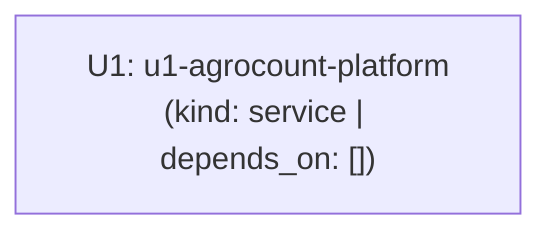

# Grafo de Dependências entre Unidades (Unit of Work Dependency DAG)

Elaborado a partir de `domain-design/components.md` (`components.md`), `domain-design/decisions.md` (`decisions.md`), `requirements-analysis/requirements.md` (`requirements.md`), `user-stories/stories.md` (`stories.md`) e `unit-of-work.md`.

## Bloco Legível por Máquina (Machine-Readable Dependency DAG)

```yaml
units:
  - name: u1-agrocount-platform
    kind: service
    depends_on: []
```

---

## Topologia, Pontos de Integração e Walking Skeleton

### Topologia do Grafo (Acyclic DAG)


**Equivalente em texto:**
- `u1-agrocount-platform` (`kind: service`, `depends_on: []`) — unidade raiz autocontida, livre de ciclos.

### Fatia Integrada Ponta a Ponta (Walking Skeleton)
Conforme a prática de *Walking Skeleton*, a unidade `U1` (`u1-agrocount-platform`) é a primeira e única unidade do DAG e constitui por completo a fatia funcional integrada de ponta a ponta:
- **Fluxo integrado exercitado em `u1-agrocount-platform`:** Cadastro de Fazenda e Piquete $\rightarrow$ Upload e validação de mídia aérea $\rightarrow$ Inferência de visão computacional (YOLO + SAHI / ByteTrack) com separação entre `high_confidence` ($\ge 0{,}75$) e `uncertain` ($0{,}25\text{–}0{,}74$) $\rightarrow$ Revisão *Human-in-the-Loop* (+FN / -FP) com geração automática de amostra YOLO no *Golden Dataset* $\rightarrow$ *Fine-Tuning* com trava de promoção $\ge 95\%$ $\rightarrow$ Exportação de laudo auditado PDF/CSV.

### Pontos de Integração e Contratos
- **Fronteiras Internas entre Componentes:** Respeitam estritamente o grafo acíclico de `components.md` (`WebReviewStudioComponent` $\rightarrow$ `InspectionManagementComponent` / `HitlActiveLearningComponent` $\rightarrow$ `CattleVisionEngineComponent`).
- **Fronteira Externa Pública:** `u1-agrocount-platform` expõe a API HTTP/REST consumida pelo cliente web e potenciais integrações externas, cujo contrato OpenAPI formal é especificado na etapa de `contract-design`.
