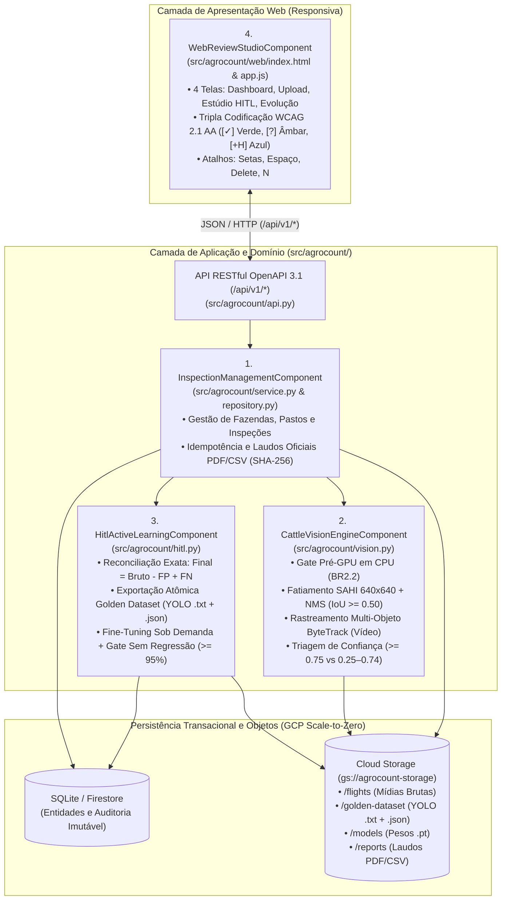
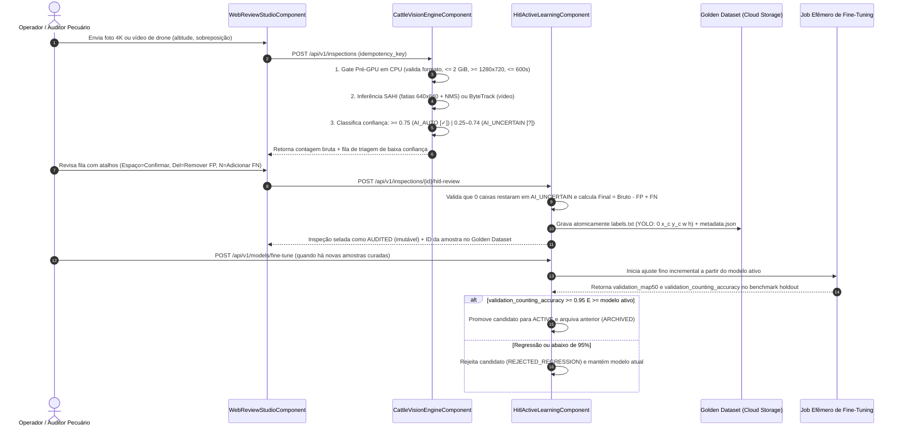

# Arquitetura Completa e Documentação Técnica — AgroCount IA (`u1-agrocount-platform`)

Este documento consolida em um único lugar toda a arquitetura funcional, de domínio, de infraestrutura GCP *scale-to-zero* e do ciclo **Human-in-the-Loop (Active Learning)** da plataforma **AgroCount IA**, além do índice navegável para todos os documentos detalhados gerados nas 19 etapas do ciclo AI-DLC.

---

## 1. Visão Geral da Arquitetura de Domínio e Componentes

A aplicação foi estruturada na unidade integrada **`u1-agrocount-platform` (`U1`)**, composta por 4 componentes de domínio coesos:

---

## 2. Arquitetura Detalhada do Ciclo *Human-in-the-Loop (Active Learning)*

O diferencial técnico central do **AgroCount IA** é transformar cada revisão humana do auditor em melhoria mensurável do modelo de visão computacional, sem risco de regressão:

---

## 3. Infraestrutura Google Cloud Platform (GCP) e Estimativa de Custos (*Scale-to-Zero*)

A arquitetura na região `southamerica-east1` (São Paulo) utiliza exclusivamente serviços *serverless* com escalonamento a zero (`min-instances = 0`), garantindo custo zero de GPU quando não há voos sendo processados:

| Serviço GCP | Papel na Arquitetura | Configuração *Scale-to-Zero* | Custo Mensal Estimado (MVP: ~50–100 voos/mês) |
|---|---|---|---|
| **Cloud Run (API + Web Studio)** | Hospeda a aplicação web e a API REST (`agrocount-ia`) | `min-instances=0`, `max-instances=10`, CPU sob demanda | **US$ 0 – US$ 5 / mês** (coberto pelo *free tier*) |
| **Cloud Run Jobs / GPU L4** | Processamento pesado YOLO + SAHI / ByteTrack sob demanda | NVIDIA L4 (24 GB VRAM), acionado apenas durante o upload | **US$ 10 – US$ 25 / mês** (~US$ 0,70/hora de GPU ativa) |
| **Vertex AI Custom Training Job** | *Fine-tuning* sob demanda do modelo com o *Golden Dataset* | Máquina `g2-standard-4` (L4 Spot/Preemptible) | **US$ 3 – US$ 8 / mês** (2 a 4 retreinos/mês) |
| **Cloud Storage (`gs://agrocount-storage`)** | Armazena mídias de drone, *Golden Dataset* YOLO, pesos `.pt` e laudos PDF/CSV | Standard + Lifecycle para Archive após 90 dias | **US$ 2 – US$ 6 / mês** |
| **Firestore / Artifact Registry / Logging** | Metadados de auditoria, imagens Docker e observabilidade | Camada gratuita / Pay-as-you-go | **US$ 0 – US$ 3 / mês** |
| **TOTAL ESTIMADO (MVP)** | **Operação Completa com Ciclo HITL Ativo** | **100% *Serverless*** | **~US$ 15 a US$ 47 / mês** (~R$ 85 a R$ 260/mês) |

---

## 4. Mapa Completo da Documentação Gerada (19 Etapas AI-DLC)

Todos os artefatos de engenharia de produto, UX, arquitetura, banco de dados, requisitos não-funcionais, testes e CI/CD estão versionados no diretório [`aidlc/spaces/default/intents/261022-contagem-de-bois/`](../aidlc/spaces/default/intents/261022-contagem-de-bois/):

### Fase 1 — Ideation (Concepção, Viabilidade, Escopo e Wireframes)
1. **Intent Capture:** [`ideation/intent-capture/intent-spec.md`](../aidlc/spaces/default/intents/261022-contagem-de-bois/ideation/intent-capture/intent-spec.md) — Problema de negócio, objetivos e métricas de sucesso.
2. **Feasibility Analysis:** [`ideation/feasibility/feasibility-analysis.md`](../aidlc/spaces/default/intents/261022-contagem-de-bois/ideation/feasibility/feasibility-analysis.md) — Viabilidade técnica YOLO + SAHI + HITL e análise financeira de custos GCP.
3. **Scope Definition:** [`ideation/scope-definition/scope-spec.md`](../aidlc/spaces/default/intents/261022-contagem-de-bois/ideation/scope-definition/scope-spec.md) — Fronteiras do MVP, itens incluídos/excluídos e premissas.
4. **Rough Mockups:** [`ideation/rough-mockups/rough-mockups.md`](../aidlc/spaces/default/intents/261022-contagem-de-bois/ideation/rough-mockups/rough-mockups.md) — Wireframes iniciais das 4 telas e fluxo de navegação.

### Fase 2 — Inception (Práticas, Requisitos, Histórias, UX Refinado, Domínio, Contratos e Plano de Entrega)
5. **Practices Discovery:** [`inception/practices-discovery/team-practices.md`](../aidlc/spaces/default/intents/261022-contagem-de-bois/inception/practices-discovery/team-practices.md) — Práticas afirmadas (*trunk-based*, `test-after`, piso de 80% de cobertura).
6. **Requirements Analysis:** [`inception/requirements-analysis/requirements.md`](../aidlc/spaces/default/intents/261022-contagem-de-bois/inception/requirements-analysis/requirements.md) — Requisitos Funcionais (`FR1.1`–`FR6.1`) e Não-Funcionais (`NFR1`–`NFR6`).
7. **User Stories & Personas:**
   - [`inception/user-stories/personas.md`](../aidlc/spaces/default/intents/261022-contagem-de-bois/inception/user-stories/personas.md) — Personas (Operador/Auditor, Gestor Pecuário, Engenheiro de IA/MLOps).
   - [`inception/user-stories/stories.md`](../aidlc/spaces/default/intents/261022-contagem-de-bois/inception/user-stories/stories.md) — 15 histórias (`US1.1`–`US6.1`) com critérios Gherkin (`AC1.1.1`–`AC6.1.1`).
8. **Refined Mockups & Acessibilidade WCAG 2.1 AA:**
   - [`inception/refined-mockups/mockups.md`](../aidlc/spaces/default/intents/261022-contagem-de-bois/inception/refined-mockups/mockups.md) — Mockups de alta fidelidade das 4 telas.
   - [`inception/refined-mockups/interaction-spec.md`](../aidlc/spaces/default/intents/261022-contagem-de-bois/inception/refined-mockups/interaction-spec.md) — Especificação de interações, estados e atalhos de teclado.
   - [`inception/refined-mockups/design-system-mapping.md`](../aidlc/spaces/default/intents/261022-contagem-de-bois/inception/refined-mockups/design-system-mapping.md) — Tokens visuais, cores de alto contraste sob luz solar e seletores `data-testid`.
   - [`inception/refined-mockups/accessibility-checklist.md`](../aidlc/spaces/default/intents/261022-contagem-de-bois/inception/refined-mockups/accessibility-checklist.md) — Codificação tripla para daltonismo (`[✓]`, `[?]`, `[+H]`).
9. **Domain Design & ADRs:**
   - [`inception/domain-design/components.md`](../aidlc/spaces/default/intents/261022-contagem-de-bois/inception/domain-design/components.md) — Os 4 componentes de domínio e contextos delimitados (DDD).
   - [`inception/domain-design/decisions.md`](../aidlc/spaces/default/intents/261022-contagem-de-bois/inception/domain-design/decisions.md) — ADRs (`ADR-001` SAHI + ByteTrack, `ADR-002` Ciclo HITL + Gate Sem Regressão, `ADR-003` GCP Scale-to-Zero).
10. **Units Generation:** [`inception/units-generation/unit-of-work.md`](../aidlc/spaces/default/intents/261022-contagem-de-bois/inception/units-generation/unit-of-work.md) — Definição da unidade `u1-agrocount-platform` (`U1`).
11. **Contract Design:** [`inception/contract-design/contract-summary.md`](../aidlc/spaces/default/intents/261022-contagem-de-bois/inception/contract-design/contract-summary.md) — Contratos OpenAPI 3.1 (`/api/v1/*`) e schema JSON do *Golden Dataset*.
12. **Delivery Planning:** [`inception/delivery-planning/bolt-plan.md`](../aidlc/spaces/default/intents/261022-contagem-de-bois/inception/delivery-planning/bolt-plan.md) — Plano de entrega e mitigação de riscos.

### Fase 3 — Construction (Projeto Detalhado, NFRs, Infraestrutura, Código, Testes e CI)
13. **Functional Design:**
    - [`construction/u1-agrocount-platform/functional-design/entities.md`](../aidlc/spaces/default/intents/261022-contagem-de-bois/construction/u1-agrocount-platform/functional-design/entities.md) — Modelo físico/lógico das 10 entidades e máquinas de estado.
    - [`construction/u1-agrocount-platform/functional-design/rules.md`](../aidlc/spaces/default/intents/261022-contagem-de-bois/construction/u1-agrocount-platform/functional-design/rules.md) — As 14 regras de negócio (`BR1.1`–`BR6.1`).
    - [`construction/u1-agrocount-platform/functional-design/functional-spec.md`](../aidlc/spaces/default/intents/261022-contagem-de-bois/construction/u1-agrocount-platform/functional-design/functional-spec.md) — Fluxos e algoritmos detalhados (SAHI + NMS, ByteTrack, exportação YOLO, Gate de Promoção).
14. **NFR Requirements:**
    - [`construction/u1-agrocount-platform/nfr-requirements/performance-requirements.md`](../aidlc/spaces/default/intents/261022-contagem-de-bois/construction/u1-agrocount-platform/nfr-requirements/performance-requirements.md)
    - [`construction/u1-agrocount-platform/nfr-requirements/security-requirements.md`](../aidlc/spaces/default/intents/261022-contagem-de-bois/construction/u1-agrocount-platform/nfr-requirements/security-requirements.md)
    - [`construction/u1-agrocount-platform/nfr-requirements/scalability-requirements.md`](../aidlc/spaces/default/intents/261022-contagem-de-bois/construction/u1-agrocount-platform/nfr-requirements/scalability-requirements.md)
    - [`construction/u1-agrocount-platform/nfr-requirements/reliability-requirements.md`](../aidlc/spaces/default/intents/261022-contagem-de-bois/construction/u1-agrocount-platform/nfr-requirements/reliability-requirements.md)
    - [`construction/u1-agrocount-platform/nfr-requirements/observability-requirements.md`](../aidlc/spaces/default/intents/261022-contagem-de-bois/construction/u1-agrocount-platform/nfr-requirements/observability-requirements.md)
    - [`construction/u1-agrocount-platform/nfr-requirements/tech-stack-decisions.md`](../aidlc/spaces/default/intents/261022-contagem-de-bois/construction/u1-agrocount-platform/nfr-requirements/tech-stack-decisions.md)
15. **NFR Design:**
    - [`construction/u1-agrocount-platform/nfr-design/logical-components.md`](../aidlc/spaces/default/intents/261022-contagem-de-bois/construction/u1-agrocount-platform/nfr-design/logical-components.md)
    - [`construction/u1-agrocount-platform/nfr-design/performance-design.md`](../aidlc/spaces/default/intents/261022-contagem-de-bois/construction/u1-agrocount-platform/nfr-design/performance-design.md)
    - [`construction/u1-agrocount-platform/nfr-design/security-design.md`](../aidlc/spaces/default/intents/261022-contagem-de-bois/construction/u1-agrocount-platform/nfr-design/security-design.md)
    - [`construction/u1-agrocount-platform/nfr-design/reliability-design.md`](../aidlc/spaces/default/intents/261022-contagem-de-bois/construction/u1-agrocount-platform/nfr-design/reliability-design.md)
16. **Infrastructure Design:**
    - [`construction/u1-agrocount-platform/infrastructure-design/infrastructure-specification.md`](../aidlc/spaces/default/intents/261022-contagem-de-bois/construction/u1-agrocount-platform/infrastructure-design/infrastructure-specification.md)
    - [`construction/u1-agrocount-platform/infrastructure-design/monitoring-design.md`](../aidlc/spaces/default/intents/261022-contagem-de-bois/construction/u1-agrocount-platform/infrastructure-design/monitoring-design.md)
    - [`construction/u1-agrocount-platform/infrastructure-design/cicd-pipeline.md`](../aidlc/spaces/default/intents/261022-contagem-de-bois/construction/u1-agrocount-platform/infrastructure-design/cicd-pipeline.md)
17. **Code Generation:**
    - [`construction/u1-agrocount-platform/code-generation/code-generation-plan.md`](../aidlc/spaces/default/intents/261022-contagem-de-bois/construction/u1-agrocount-platform/code-generation/code-generation-plan.md)
    - [`construction/u1-agrocount-platform/code-generation/code-summary.md`](../aidlc/spaces/default/intents/261022-contagem-de-bois/construction/u1-agrocount-platform/code-generation/code-summary.md)
18. **Build and Test:**
    - [`construction/build-and-test/build-and-test-summary.md`](../aidlc/spaces/default/intents/261022-contagem-de-bois/construction/build-and-test/build-and-test-summary.md)
    - [`construction/build-and-test/test-results.md`](../aidlc/spaces/default/intents/261022-contagem-de-bois/construction/build-and-test/test-results.md) (14/14 testes aprovados, **94,3% de cobertura**)
    - [`construction/build-and-test/cross-unit-traceability.md`](../aidlc/spaces/default/intents/261022-contagem-de-bois/construction/build-and-test/cross-unit-traceability.md)
19. **CI Pipeline:**
    - [`construction/ci-pipeline/ci-config.md`](../aidlc/spaces/default/intents/261022-contagem-de-bois/construction/ci-pipeline/ci-config.md)
    - [`construction/ci-pipeline/quality-gates.md`](../aidlc/spaces/default/intents/261022-contagem-de-bois/construction/ci-pipeline/quality-gates.md)
    - [`.github/workflows/ci.yml`](../.github/workflows/ci.yml)
